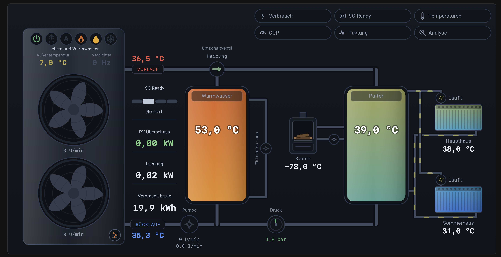

# Heatpump Flow Card by Lutarym

[English](README.md) · **Deutsch** · [Français](README.fr.md) · [日本語](README.ja.md)



Animierte Lovelace-Karte für Home Assistant, die eine Panasonic-Aquarea-Wärmepumpe als lebendiges Anlagenschema zeigt, angebunden über HeishaMon.

## Funktionen

- Anlagenschema mit Außengerät, Heizungspuffer, einem oder zwei Heizkreisen, Warmwasserspeicher und Zirkulation
- Fließanimation, die der tatsächlichen Hydraulik folgt: Umschaltventil, Pumpen, Verdichter und Puffer
- Temperaturabhängige Einfärbung von Speichern, Heizkörpern und Leitungen
- Heizkurve für Heizkreis 1 und 2 in einem eigenen Fenster, mit Skala, Betriebspunkt und einstellbaren Eckwerten
- Tür in der Wärmepumpe: Der Knopf unten rechts klappt die Front wie eine Tür nach links auf, dahinter liegen erweiterte Einstellungen (Urlaub, Wochenprogramm, Smart DHW, Heizgrenzen, Spreizung, Legionellenschutz, Pumpe, Leisemodus, COP von heute für Heizen und Warmwasser (Wärme durch Strom seit Mitternacht), Jahresarbeitszahl (JAZ) für Heizen, Warmwasser und gesamt seit 1. Januar, mit Wärme und Strom in kWh, aus den HeishaMon-Werten, Betriebsstunden und Starts); Änderungen werden mit „Übernehmen“ gesendet und die Tür schließt sich
- Hilfefenster („?“ unten rechts): verständliche Erklärung aller Werte und Befehle, die HeishaMon lesen und schreiben kann, mit Suche und Gruppen; zu jedem TOP-Wert die vollständige Entität, per Klick kopierbar
- Geräteprofile für 35 Integrationen von 24 Herstellern (Viessmann, NIBE, Daikin, Luxtronik, Stiebel Eltron, Vaillant und weitere) als Dateien im Ordner `dist/Profile`, eine Datei je Hersteller mit einer Variante je Integration. Die Karte erkennt die passende Variante selbst; werden mehrere gefunden, fragt der Editor, welche gelten soll, passt keine, fragt er nach einem bestimmten Profil. Außer HeishaMon by Lutarym und HeishaMon (MQTT) sind sie ungetestet. Profile lassen sich exportieren, anpassen, importieren und auf GitHub suchen; siehe [Anleitung Geräteprofile](docs/GERAETEPROFIL.de.md) und [Namensliste](docs/NAMENSLISTE.de.md)
- Sprachpakete: eine Sprache als Datei exportieren, selbst übersetzen oder anpassen und wieder importieren; siehe [Anleitung Sprachpakete](docs/SPRACHPAKET.de.md)
- Verbrauchsverlauf der letzten 24 Stunden, gefärbt nach Heizung, Warmwasser und Standby, darunter der SG-Ready-Verlauf
- Anlagen ohne Heizungspuffer, automatisch erkannt über TOP99 oder fest einstellbar
- Analyse mit einem Reiter je Optimierung (Heizkurve, Takten, Pumpe, Warmwasser, Heizstab, Abtauen, Effizienz, Strom & PV, Anlage), in einfachen Worten erklärt, mit Richtwerten und Quellen; nutzt die Auswertungen von HeishaMon by Lutarym ab 1.7.0 und die Werte von HeishaMon 4.3.0 und 4.4.x (TOP144 bis TOP198)
- Quer- und Hochformat
- Grafischer Editor mit automatischer Erkennung der Integration, Konfiguration aus- und einlesen
- Vier Sprachen: Englisch, Deutsch, Französisch und Japanisch

## Voraussetzungen

- Home Assistant 2024.1.0 oder neuer
- HeishaMon, angebunden entweder über die Integration HeishaMon by Lutarym oder über MQTT
- Zum Schreiben der Heizkurve über MQTT: die MQTT-Integration in Home Assistant

## Installation

### HACS

1. HACS öffnen, Menü mit den drei Punkten, Benutzerdefinierte Repositories
2. Repository: `https://github.com/Lutarym/Heatpump-Flow-Card-by-Lutarym`, Kategorie: **Dashboard**
3. Die Karte suchen und herunterladen
4. HACS legt die Ressource selbst an. Laufen deine Dashboards im YAML-Modus, trage sie selbst ein, siehe unten
5. Browser ohne Zwischenspeicher neu laden

### Manuell

1. `heatpump-flow-card-by-lutarym.js`, `heatpump-flow-card-by-lutarym-hilfe.js` und den Ordner `Profile` aus dem Ordner `dist` des neuesten Release herunterladen
2. Alles nach `<config>/www/community/heatpump-flow-card-by-lutarym/` kopieren, den Ordner `Profile` als Unterordner. Die zweite Datei enthält die Hilfe und wird nur bei Bedarf geladen, der Ordner `Profile` die Geräteprofile; als Ressource eingetragen wird nur die erste Datei.
3. Einstellungen, Dashboards, Menü mit den drei Punkten, Ressourcen, Ressource hinzufügen
4. URL `/local/community/heatpump-flow-card-by-lutarym/heatpump-flow-card-by-lutarym.js`, Typ **JavaScript-Modul**

## Konfiguration

Am einfachsten über den grafischen Editor: Karte hinzufügen und **Aus Integration übernehmen** drücken. Die Karte erkennt die Entitäten über die Geräteprofile selbst, zum Beispiel bei HeishaMon by Lutarym. Passt kein Profil, fragt der Editor nach einem bestimmten Profil. Nicht gefundene Entitäten lassen sich von Hand zuordnen.

### Beispiel in YAML

```yaml
type: custom:heatpump-flow-card-by-lutarym
layout: quer
hk_count: 2
language: auto
entities:
  TOP14: sensor.heishamon_top14
  TOP6: sensor.heishamon_top6
  TOP5: sensor.heishamon_top5
  TOP8: sensor.heishamon_top8
  TOP20: sensor.heishamon_top20
  TOP46: sensor.heishamon_top46
  TOP10: sensor.heishamon_top10
  TOP36: sensor.heishamon_top36
  TOP42: sensor.heishamon_top42
```

Die Entitäts-IDs sind die Standardnamen der Karte. Deine Entitäten können anders heißen, der Editor ordnet sie selbst zu.

Die Schlüssel sind ab 6.0.0 die Namen der [Namensliste](docs/NAMENSLISTE.de.md). Frühere Feldnamen wie `outside_temp` gelten weiter, die Karte stellt sie selbst um.

### Optionen

| Option | Vorgabe | Bedeutung |
|---|---|---|
| `layout` | `quer` | `quer` Querformat, `hoch` Hochformat, `klassisch` Querformat wie bis Version 4.9 (höchstens 2 Heizkreise, ohne Zusatzwärme) |
| `hk_count` | `2` | Anzahl der Heizkreise, 1 bis 4. HK3 und HK4 brauchen eigene Entitäten, die Aquarea regelt nur zwei Zonen |
| `fan_count` | `2` | Anzahl der Lüfter, 1 oder 2 |
| `language` | `auto` | `auto`, `de`, `en`, `fr` oder `ja` |
| `profil` | `auto` | `auto` erkennt die passende Variante selbst, `keins` ohne Profil (nur eingetragene Entitäten), sonst die Kennung einer Variante wie `heishamon_lutarym`, `heishamon` (HeishaMon über MQTT), `vicare`, `luxtronik2`; Liste in der [Anleitung](docs/GERAETEPROFIL.de.md) |
| `buffer_present` | `auto` | Heizungspuffer: `auto` aus TOP99, `true` oder `false` |
| `cop_reference` | leer | Datenblatt für den COP-Vergleich: `panasonic_tcap_m_12` (Panasonic Aquarea T-CAP M 12 kW, WH-WXG12ME5/ME8). Nur damit färbt der Reiter COP jeden Lauf: grün ab 92 % des Datenblatts (Toleranz −8 %, HP KEYMARK), gelb darunter, außerhalb der Prüfpunkte nur geschätzt, als Schätzung gekennzeichnet und blass gezeichnet. Leer: COP ohne Bewertung |
| `dhw_usable_temp` | leer | Speichertemperatur in °C, unter der das Warmwasser als nicht mehr nutzbar gilt. Für die Haltezeit im Fenster „Warmwasser beobachten“ (Knopf im Fenster der Wärmepumpe). Leer: Spalte ohne Wert |
| `heat_load_kw` | leer | Norm-Heizlast des Hauses in kW (DIN EN 12831). Mit `design_outdoor_temp`, `hp_capacity_kw` und der Heizgrenze TOP77 rechnet die Analyse den Bivalenzpunkt und vergleicht „Heizstab ein unter“ (TOP78) und die Laufzeit des Heizstabs damit |
| `design_outdoor_temp` | leer | Norm-Außentemperatur des Standorts in °C, z. B. aus der BWP-Klimakarte nach Postleitzahl |
| `hp_capacity_kw` | leer | Heizleistung der Wärmepumpe in kW laut Datenblatt, bei Norm-Außentemperatur und deiner Vorlauftemperatur; fehlt er, der Wert bei −7 °C. Gilt als gleichbleibend |
| `hp_capacity_ref` | leer | Wofür `hp_capacity_kw` gilt: leer = Norm-Außentemperatur, `a7` = −7 °C (Herstellerangabe). Der Analysepunkt „Heizleistung, Auslegung“ nutzt den Leistungsanteil (Heizleistung / Norm-Heizlast) aus dem BWP-Leitfaden: unter 50 % (mit dem Wert bei −7 °C unter 70 %) ein Hinweis „zu klein“ mit den fehlenden kW, darüber „in Ordnung“ ohne Hinweis |
| `heater_share_max` | leer | Deine Vorgabe: höchstens dieser Anteil der Heizwärme im Jahr in % vom Heizstab. Der Analysepunkt „Heizleistung, Auslegung“ zeigt dann einen Hinweis mit den fehlenden kW. Leer: Anteil ohne Bewertung |
| `hk1_room_target` | leer | Wunsch-Raumtemperatur von HK1 in °C. Die Analyse (Reiter Heizkurve) vergleicht sie mit dem Raumfühler `EXT201`: innerhalb von ±0,5 K in Ordnung (eigene Festlegung: Schrittweite der Eingabe), sonst leichte Abweichung mit dem Vorgehen nach EnergieSchweiz |
| `hk2_room_target` | leer | Wie `hk1_room_target`, für HK2 und `EXT203` |
| `circulation_present` | `auto` | Zirkulation: `auto` sobald eine Entität zugeordnet ist, `true` oder `false` |
| `show_history` | `knopf` | Diagramme: `knopf` sechs Knöpfe oben rechts öffnen Verbrauch, SG Ready, Temperaturen, COP, Taktung und Analyse im Fenster (dort zusätzlich der Reiter Abtauen), Zeitraum wählbar von 24 Stunden bis 1 Jahr, `true` Verbrauch dauerhaft in der Karte, `false` aus |
| `show_target` | `true` | Zeile „Ziel …“ in Puffer und Warmwasser anzeigen |
| `show_reload` | `true` | Zeile „Lädt ab …“ in Puffer und Warmwasser anzeigen |
| `show_help` | `true` | Knopf „?“ für die Hilfe unten rechts in der Karte anzeigen; die Hilfe beschreibt HeishaMon und erscheint nur bei HeishaMon-Profilen und im Demomodus |
| `show_door` | `true` | Knopf für die erweiterten Einstellungen unten rechts an der Wärmepumpe anzeigen |
| `theme` | `auto` | Farbdarstellung: `auto` (folgt hell/dunkel von Home Assistant), `dunkel`, `hell`, `kontrast` (hoher Kontrast), `nacht` (gedimmt), `ha` (Farben des Home-Assistant-Designs) |
| `profile_custom` | `[]` | Importierte und von GitHub geladene Geräteprofile (setzt der Editor, siehe [Anleitung](docs/GERAETEPROFIL.de.md)) |
| `language_custom` | `[]` | Importierte Sprachpakete (setzt der Editor, siehe [Anleitung](docs/SPRACHPAKET.de.md)) |
| `history_width` | `450` | Breite des Verbrauchsverlaufs, 250 bis 700 |
| `history_style` | `takte` | Darstellung des Verbrauchs: `takte` (Ring und Taktband), `balken` (Balken je Stunde), `leuchten` (leuchtende Linie mit Taktmarken), `linie` (bisherige Linie) |
| `sg_style` | `spuren` | Darstellung von SG Ready: `spuren` (Spuren je Zustand), `stufen` (Stufenlinie), `uhr` (24-Stunden-Uhr), `band` (breites Band mit Anteilsleiste) |
| `power_style` | `verlauf` | Darstellung von Strom & PV in der Analyse: `verlauf` (Sonnenverlauf), `bogen` (Sonnenbogen von heute, ab zwei Tagen im Zeitraum dazu die einzelnen Tage), `balken` (Balken je Stunde, je 3 Stunden oder je Tag, ab zwei Tagen dazu ein Raster je Tag und Stunde). Der Zeitraum zählt in Kalendertagen: 24 Stunden heißt heute ab Mitternacht |
| `card_width` | `0` | Breite in Pixeln, 0 ist automatisch |
| `card_height` | `0` | Höhe in Pixeln, 0 ist automatisch |
| `pipe_inner_mm` | `0` | Rohrinnendurchmesser in mm, färbt den Durchfluss, 0 ist aus |
| `mqtt_prefix` | `panasonic_heat_pump` | MQTT-Präfix von HeishaMon |
| `curve_x_min / curve_x_max` | `-20 / 20` | Außenskala der Heizkurve in °C |
| `curve_y_min / curve_y_max` | `20 / 75` | Vorlaufskala der Heizkurve in °C |
| `scale_min / scale_max` | `20 / 60` | Farbskala der Heizung in °C |
| `outdoor_min / outdoor_max` | `-15 / 35` | Farbskala des Außenfühlers in °C |
| `label_hk1` bis `label_hk4`, `label_buffer, label_dhw, label_energy` | | Eigene Namen, leer nimmt die Kartensprache |
| `energy_daily` | `true` | Tagesverbrauch aus dem Zählerstand rechnen |
| `animate` | `true` | Animation: `true` ein, `false` aus, `auto` das Gerät entscheidet (Einstellung „Bewegung reduzieren“) |
| `debug` | `false` | Zeigt oben links ein kleines Feld, was die Animation gerade tut (Kacheln, laufende Animationen, Umbauten, Bilder je Sekunde), dazu einen Knopf, der die Animationen neu startet. Zur Fehlersuche bei der Animation |
| `hk1_style` bis `hk4_style` | `platte` | Bild des Heizkreises: `platte` Plattenheizkörper, `glieder` Gliederheizkörper, `fbh` Fußbodenheizung (Zimmerecke mit Rohrschlange im Boden) |
| `extra_heat` | `aus` | Zusatzwärme am Puffer: `aus`, `kamin`, `solar`, `beide`. Nur mit Heizungspuffer |
| `kamin_fire_temp` | `30` | Ab dieser Kamintemperatur in °C lodert das Feuer im Kamin |
| `solar_sun_temp` | `30` | Ab dieser Kollektortemperatur in °C scheint die Sonne über der Solarthermie |
| `solar_style` | `strahlen` | Darstellung der Solarthermie: `strahlen` (Lichtstrahlen und Zellenwelle), `funkeln` (Aufwärmen und Funkeln), `roehren` (Röhrenkollektor) |
| `demo` | `false` | Beispielwerte zum Ausprobieren |

### Entitäten

Alle Felder sind optional. Ein Feld ohne Entität wird auf der Karte ausgeblendet. Wo ein Befehlsname steht, kann die Karte den Wert über HeishaMon schreiben.

| Schlüssel | Bedeutung | Hinweis |
|---|---|---|
| **Außenfühler** | | |
| `TOP14` | Außentemperatur | |
| **Außengerät** | | |
| `SET1` | Wärmepumpe Status, grüne LED | SetHeatpump oder TOP0 |
| `TOP8` | Verdichterdrehzahl | |
| `TOP62` | Lüfter 1 Drehzahl | |
| `TOP63` | Lüfter 2 Drehzahl | |
| `TOP26` | Abtauung läuft | |
| `TOP44` | Fehlercode | |
| `TOP0` | Betriebszustand | |
| `SET12` | Abtauen erzwingen | SetForceDefrost, switch |
| `SET4` | Turbomodus | SetPowerfulMode, select |
| `SET3` | Leisemodus | SetQuietMode, select |
| `EXT1` | Aktuelle Leistungsaufnahme | Shelly PM, Watt |
| `EXT2` | Energiezähler | Shelly PM, kWh |
| **SG Ready** | | |
| `EXT3` | PV Leistung aktuell | eigene Entität, Watt |
| `EXT4` | Netzbezug | eigene Entität, Watt, positiv = Bezug. Mit `EXT1` rechnet die Karte daraus „Netzstrom heute“, wenn HeishaMon by Lutarym (Option „Netzbezug-Sensor“) den Wert nicht liefert |
| `EXT100` | Kontakt K1 Sperre | Shelly, Relais oder Eingang |
| `EXT101` | Kontakt K2 Anlauf | Shelly, Relais oder Eingang |
| **Primärkreis** | | |
| `TOP6` | Vorlauftemperatur | |
| `TOP5` | Rücklauftemperatur | |
| `TOP65` | Primärpumpe Drehzahl | |
| `TOP1` | Durchflussmenge | |
| `TOP20` | 3-Wege-Umschaltventil | |
| `TOP115` | Wasserdruck | |
| `TOP60` | Heizstab intern läuft | |
| `TOP61` | Heizstab extern läuft | |
| **Heizungspuffer** | | |
| `TOP46` | Puffertemperatur | |
| `TOP99` | Puffer vorhanden | |
| `SET28` | Pufferbetrieb ein und aus | SetBuffer, switch |
| **Heizkurve** | | |
| `TOP29` | HK1 Heizkurve Vorlauf oben | |
| `TOP30` | HK1 Heizkurve Vorlauf unten | |
| `TOP31` | HK1 Heizkurve Außen oben | |
| `TOP32` | HK1 Heizkurve Außen unten | |
| `TOP82` | HK2 Heizkurve Vorlauf oben | |
| `TOP83` | HK2 Heizkurve Vorlauf unten | |
| `TOP84` | HK2 Heizkurve Außen oben | |
| `TOP85` | HK2 Heizkurve Außen unten | |
| **Heizungspuffer** | | |
| `TOP113` | Puffer Überhöhung (ΔT) | Pufferziel = Heizkreis-Soll + ΔT |
| `TOP7` | Vorlauf-Soll Wärmepumpe | |
| `EXT600` | COP Heizen | HeishaMon by Lutarym, nur ohne Leistungswerte der Wärmepumpe genutzt (sonst Wärme durch Strom aus TOP15/TOP16); Quelle in der Integration unter COP Quelle wählbar |
| `TOP59` | Heizstab Heizung freigegeben | |
| `SET45` | Heizstab Heizung freigeben | SetRoomHeaterState, switch |
| **Heizkreis 1** | | |
| `TOP94` | Aktivierte Zonen | gilt für beide |
| `SET17` | Zonen umschalten | SetZones, gilt für beide |
| `TOP36` | HK1 Wassertemperatur | |
| `TOP42` | HK1 Wasser Sollwert | |
| `TOP124` | HK1 Pumpe läuft | |
| `TOP27` | HK1 Sollwert einstellbar | number |
| `EXT200` | HK1 ein und aus | eigener Schalter, optional |
| `EXT201` | HK1 Raumtemperatur | Raumfühler, optional |
| **Heizkreis 2** | | |
| `TOP37` | HK2 Wassertemperatur | |
| `TOP43` | HK2 Wasser Sollwert | |
| `TOP123` | HK2 Pumpe läuft | |
| `TOP34` | HK2 Sollwert einstellbar | number |
| `EXT202` | HK2 ein und aus | eigener Schalter, optional |
| `EXT203` | HK2 Raumtemperatur | Raumfühler, optional |
| `EXT204, EXT207` | Wassertemperatur HK3, HK4 | eigene Entität, °C |
| `EXT205, EXT208` | Pumpe HK3, HK4 läuft | eigener Schalter oder Sensor |
| `EXT206, EXT209` | HK3, HK4 ein und aus | eigener Schalter, optional |
| `EXT300` | Kamin Temperatur | eigene Entität, °C; Kamin allein: TOP47 |
| `EXT301` | Kamin Pumpe läuft | eigener Schalter oder Sensor; Kamin allein: OPT5 |
| `TOP47` | Solarthermie Temperatur | |
| `OPT5` | Solarthermie Pumpe läuft | |
| **Warmwasser** | | |
| `TOP100` | Warmwasser vorhanden | |
| `TOP10` | Warmwasser Isttemperatur | |
| `TOP22` | Warmwasser Hysterese | |
| `TOP9` | Warmwasser Sollwert | number |
| `EXT601` | COP Warmwasser | HeishaMon by Lutarym, nur ohne Leistungswerte der Wärmepumpe genutzt (sonst Wärme durch Strom aus TOP40/TOP41); Quelle in der Integration unter COP Quelle wählbar |
| `TOP58` | Heizstab Warmwasser freigegeben | |
| `SET10` | Einmalig aufheizen | SetForceDHW, switch |
| `TOP2` | Aufheizen läuft | |
| `SET13` | Legionellenschutz starten | SetForceSterilization, switch |
| `TOP69` | Legionellenschutz läuft | |
| `SET44` | Heizstab Warmwasser freigeben | SetDHWHeaterState, switch |
| `EXT400` | Zirkulationspumpe läuft | Shelly oder eigener Schalter |
| `EXT401` | Zirkulation Schalter (klickbar) | Switch zum Ein/Ausschalten der Zirkulation |
| `EXT500` | Wettervorhersage | weather, stündliche Vorhersage; leer: wie HeishaMon by Lutarym, sonst automatisch. Für die beste Ladezeit im Fenster „Warmwasser beobachten“ |
| `EXT402` | Warmwasser zur wärmsten Tageszeit | HeishaMon by Lutarym ab 1.4.0, switch. Knopf im Fenster der Wärmepumpe; trennt Tage mit und ohne Plan für den Reiter „Optimierung“ im Fenster „Warmwasser beobachten“ |
| `EXT403` | Geplante Warmwasserladung | HeishaMon by Lutarym ab 1.4.0, sensor. Im Fenster der Wärmepumpe und als „Geplante Ladung“ im Reiter „Tag oder Nacht“ |
| `EXT404` | Letzte Warmwasserladung | HeishaMon by Lutarym ab 1.4.0, sensor. Im Fenster der Wärmepumpe; kennzeichnet die Ladungen, die die Integration gestartet hat |
| **Steuerung** | | |
| `SET9` | Betriebsart umschalten | SetOperationMode, select |
| **Erweiterte Einstellungen** | | |
| `TOP77` | Heizen aus ab Außentemperatur | number |
| `TOP78` | Heizstab ein unter Außentemperatur | number |
| `TOP23` | Spreizung Heizen | number |
| `SET39` | Regelung | SetHeatingControl, select |
| `TOP70` | Legionellen Temperatur | number |
| `TOP71` | Legionellen Haltezeit | number |
| `SET42` | Pumpenregelung | SetPumpFlowrateMode, select |
| `TOP95` | Max. Pumpenleistung | number |
| `SET41` | Leisemodus Vorrang | SetQuietModePriority, select |
| `SET2` | Urlaubsmodus | SetHolidayMode, switch |
| `SET24` | Wochenprogramm | SetMainSchedule, switch |
| `SET40` | Smart DHW Warmwasser | SetSmartDHW, select |
| `TOP11` | Betriebsstunden | |
| `TOP12` | Verdichterstarts | |
| `TOP90` | Heizstab Heizen Betriebsstunden | |
| `TOP91` | Heizstab Warmwasser Betriebsstunden | |

## Sprachen

Die Karte folgt der Sprache von Home Assistant. Wird diese nicht unterstützt, erscheint Englisch. Mit `language` lässt sich eine Sprache fest einstellen.

## Änderungen

Siehe [CHANGELOG.md](CHANGELOG.md).

## Lizenz

GNU General Public License v3.0, siehe [LICENSE](LICENSE).
