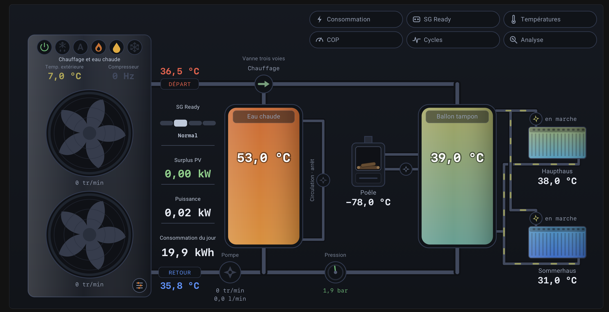

# Heatpump Flow Card by Lutarym

[English](README.md) · [Deutsch](README.de.md) · **Français** · [日本語](README.ja.md)



Carte Lovelace animée pour Home Assistant qui affiche une pompe à chaleur Panasonic Aquarea sous forme de schéma d'installation vivant, reliée par HeishaMon.

## Fonctions

- Schéma de l'installation avec unité extérieure, ballon tampon, un ou deux circuits de chauffage, ballon d'eau chaude et circulation
- Animation du débit qui suit l'hydraulique réelle : vanne trois voies, pompes, compresseur et ballon tampon
- Coloration selon la température des ballons, radiateurs et tuyaux
- Courbe de chauffe des circuits 1 et 2 dans une fenêtre dédiée, avec échelle, point de fonctionnement et points réglables
- Porte dans la pompe à chaleur : le bouton en bas à droite ouvre la façade comme une porte vers la gauche, derrière se trouvent les réglages avancés (vacances, programme hebdomadaire, Smart DHW, limites de chauffage, écart, anti-légionelles, pompe, mode silencieux, COP du jour pour chauffage et eau chaude (chaleur divisée par électricité depuis minuit), coefficient annuel (JAZ/SPF) pour chauffage, eau chaude et total depuis le 1er janvier, avec chaleur et électricité en kWh, à partir des valeurs HeishaMon, heures et démarrages) ; les modifications sont envoyées avec « Appliquer » et la porte se referme
- Fenêtre d'aide (« ? » en bas à droite) : explication simple de toutes les valeurs et commandes que HeishaMon peut lire et écrire, avec recherche et groupes ; pour chaque valeur TOP l'ID complet de l'entité, copiable d'un clic
- Profils d'appareil pour 35 intégrations de 24 fabricants (Viessmann, NIBE, Daikin, Luxtronik, Stiebel Eltron, Vaillant et d'autres) sous forme de fichiers dans le dossier `dist/Profile`, un fichier par fabricant avec une variante par intégration. La carte détecte elle-même la variante qui convient ; si plusieurs sont trouvées, l'éditeur demande laquelle utiliser, si aucune ne convient, il propose de charger un profil précis. Hormis HeishaMon by Lutarym et HeishaMon (MQTT), ils ne sont pas testés. Les profils peuvent être exportés, adaptés, importés et recherchés sur GitHub ; voir le [guide des profils](docs/GERAETEPROFIL.fr.md) et la [liste des noms](docs/NAMENSLISTE.fr.md)
- Packs de langue : exporter une langue dans un fichier, la traduire ou l'adapter et l'importer de nouveau ; voir le [guide des packs de langue](docs/SPRACHPAKET.fr.md)
- Graphique de consommation sur 24 heures, coloré selon chauffage, eau chaude et veille, avec l'historique SG Ready en dessous
- Installations sans ballon tampon, détectées automatiquement via TOP99 ou réglées manuellement
- Analyse avec un onglet par optimisation (courbe de chauffe, cycles, pompe, eau chaude, résistance, dégivrage, efficacité, électricité & PV, installation), expliquée simplement avec valeurs indicatives et sources ; utilise les évaluations de HeishaMon by Lutarym à partir de 1.7.0 et les valeurs de HeishaMon 4.3.0 et 4.4.x (TOP144 à TOP198)
- Disposition paysage et portrait
- Éditeur visuel avec détection automatique de l'intégration, import et export de la configuration
- Quatre langues : anglais, allemand, français et japonais

## Prérequis

- Home Assistant 2024.1.0 ou plus récent
- HeishaMon, relié soit par l'intégration HeishaMon by Lutarym, soit par MQTT
- Pour écrire la courbe de chauffe via MQTT : l'intégration MQTT de Home Assistant

## Installation

### HACS

1. Ouvrir HACS, menu à trois points, Dépôts personnalisés
2. Dépôt : `https://github.com/Lutarym/Heatpump-Flow-Card-by-Lutarym`, catégorie : **Dashboard**
3. Rechercher la carte et la télécharger
4. HACS enregistre la ressource automatiquement. Si vos tableaux de bord sont en mode YAML, ajoutez-la vous-même, voir ci-dessous
5. Recharger le navigateur sans cache

### Manuelle

1. Télécharger `heatpump-flow-card-by-lutarym.js`, `heatpump-flow-card-by-lutarym-hilfe.js` et le dossier `Profile` depuis le dossier `dist` de la dernière version publiée
2. Tout copier dans `<config>/www/community/heatpump-flow-card-by-lutarym/`, le dossier `Profile` comme sous-dossier. Le second fichier contient l'aide et n'est chargé qu'en cas de besoin, le dossier `Profile` contient les profils d'appareil ; seul le premier fichier est ajouté comme ressource.
3. Paramètres, Tableaux de bord, menu à trois points, Ressources, ajouter une ressource
4. URL `/local/community/heatpump-flow-card-by-lutarym/heatpump-flow-card-by-lutarym.js`, type **module JavaScript**

## Configuration

Le plus simple est l'éditeur visuel : ajouter la carte, puis appuyer sur **Reprendre de l'intégration**. La carte détecte elle-même les entités grâce aux profils d'appareil, par exemple avec HeishaMon by Lutarym. Si aucun profil ne convient, l'éditeur propose de charger un profil précis. Les entités non trouvées peuvent être attribuées à la main.

### Exemple en YAML

```yaml
type: custom:heatpump-flow-card-by-lutarym
layout: quer
hk_count: 2
language: auto
entities:
  TOP14: sensor.heishamon_top14
  TOP6: sensor.heishamon_top6
  TOP5: sensor.heishamon_top5
  TOP8: sensor.heishamon_top8
  TOP20: sensor.heishamon_top20
  TOP46: sensor.heishamon_top46
  TOP10: sensor.heishamon_top10
  TOP36: sensor.heishamon_top36
  TOP42: sensor.heishamon_top42
```

Les identifiants sont les noms par défaut de la carte. Vos entités peuvent porter d'autres noms, l'éditeur les attribue automatiquement.

À partir de 6.0.0, les clés sont les noms de la [liste des noms](docs/NAMENSLISTE.fr.md). Les anciens noms de champ comme `outside_temp` restent valables, la carte les convertit elle-même.

### Options

| Option | Défaut | Signification |
|---|---|---|
| `layout` | `quer` | `quer` paysage, `hoch` portrait, `klassisch` paysage comme jusqu'à la version 4.9 (au plus 2 circuits, sans chaleur d'appoint) |
| `hk_count` | `2` | Nombre de circuits, 1 à 4. Les circuits 3 et 4 nécessitent des entités propres, l'Aquarea ne régule que deux zones |
| `fan_count` | `2` | Nombre de ventilateurs, 1 ou 2 |
| `language` | `auto` | `auto`, `de`, `en`, `fr` ou `ja` |
| `profil` | `auto` | `auto` détecte automatiquement la variante qui convient, `keins` sans profil (seulement les entités inscrites), sinon l'identifiant d'une variante comme `heishamon_lutarym`, `heishamon` (HeishaMon via MQTT), `vicare`, `luxtronik2` ; liste dans le [guide](docs/GERAETEPROFIL.fr.md) |
| `buffer_present` | `auto` | Ballon tampon : `auto` via TOP99, `true` ou `false` |
| `cop_reference` | vide | Fiche technique pour la comparaison du COP : `panasonic_tcap_m_12` (Panasonic Aquarea T-CAP M 12 kW, WH-WXG12ME5/ME8). Seulement alors l'onglet COP colore chaque cycle : vert à partir de 92 % de la fiche technique (tolérance −8 %, HP KEYMARK), jaune en dessous, hors des points d'essai seulement estimé, signalé comme estimation et dessiné pâle. Vide : COP sans évaluation |
| `dhw_usable_temp` | vide | Température du ballon en °C en dessous de laquelle l'eau chaude n'est plus utilisable. Sert à la durée de maintien dans la fenêtre « Surveiller l'eau chaude » (bouton dans la fenêtre de la pompe à chaleur). Vide : colonne sans valeur |
| `heat_load_kw` | vide | Charge de chauffage de base de la maison en kW (EN 12831). Avec `design_outdoor_temp`, `hp_capacity_kw` et la limite de chauffage TOP77, l'analyse calcule le point de bivalence et y compare « appoint en dessous de » (TOP78) et la durée de fonctionnement de l'appoint |
| `design_outdoor_temp` | vide | Température extérieure de base du site en °C, p. ex. carte climatique BWP (Allemagne, par code postal) |
| `hp_capacity_kw` | vide | Puissance calorifique de la pompe à chaleur en kW selon la fiche technique, à la température extérieure de base et à votre température de départ ; à défaut, la valeur à −7 °C. Considérée comme constante |
| `hp_capacity_ref` | vide | À quoi s'applique `hp_capacity_kw` : vide = température extérieure de base, `a7` = −7 °C (valeur du fabricant). Le point d'analyse « Puissance, dimensionnement » utilise la part de puissance (puissance / charge de chauffage de base) du guide BWP : en dessous de 50 % (avec la valeur à −7 °C, en dessous de 70 %) une remarque « trop petite » avec les kW manquants, au-dessus « correct » sans remarque |
| `heater_share_max` | vide | Votre objectif : au maximum cette part de la chaleur de chauffage annuelle en % par l'appoint. Le point d'analyse « Puissance, dimensionnement » affiche alors une remarque avec les kW manquants. Vide : part sans évaluation |
| `hk1_room_target` | vide | Température ambiante souhaitée du circuit 1 en °C. L'analyse (onglet Courbe de chauffe) la compare à la sonde `EXT201` : à ±0,5 K près correct (choix propre : pas de saisie), sinon léger écart avec la démarche d'EnergieSchweiz |
| `hk2_room_target` | vide | Comme `hk1_room_target`, pour le circuit 2 et `EXT203` |
| `circulation_present` | `auto` | Circulation : `auto` dès qu'une entité est attribuée, `true` ou `false` |
| `show_history` | `knopf` | Graphiques : `knopf` six boutons en haut à droite ouvrent consommation, SG Ready, températures, COP, cycles et analyse dans une fenêtre (avec en plus l'onglet dégivrage), période au choix de 24 heures à 1 an, `true` consommation toujours dans la carte, `false` désactivé |
| `show_target` | `true` | Afficher la ligne « Cible … » dans le ballon tampon et l'eau chaude |
| `show_reload` | `true` | Afficher la ligne « Recharge à … » dans le ballon tampon et l'eau chaude |
| `show_help` | `true` | Afficher le bouton « ? » de l'aide en bas à droite de la carte ; l'aide décrit HeishaMon et n'apparaît qu'avec les profils HeishaMon et en mode démo |
| `show_door` | `true` | Afficher le bouton des réglages avancés en bas à droite de la pompe à chaleur |
| `theme` | `auto` | Jeu de couleurs : `auto` (suit le mode clair/sombre de Home Assistant), `dunkel` (sombre), `hell` (clair), `kontrast` (contraste élevé), `nacht` (nuit, atténué), `ha` (couleurs du thème Home Assistant) |
| `profile_custom` | `[]` | Profils d'appareil importés et chargés depuis GitHub (définis par l'éditeur, voir le [guide](docs/GERAETEPROFIL.fr.md)) |
| `language_custom` | `[]` | Packs de langue importés (définis par l'éditeur, voir le [guide](docs/SPRACHPAKET.fr.md)) |
| `history_width` | `450` | Largeur du graphique, 250 à 700 |
| `history_style` | `takte` | Style du graphique de consommation : `takte` (anneau et bande des cycles), `balken` (barres par heure), `leuchten` (ligne lumineuse avec repères de cycles), `linie` (ligne précédente) |
| `sg_style` | `spuren` | Style du graphique SG Ready : `spuren` (une ligne par état), `stufen` (ligne en escalier), `uhr` (horloge 24 heures), `band` (large bande avec barre des parts) |
| `power_style` | `verlauf` | Style du graphique Électricité & PV dans l'analyse : `verlauf` (course du soleil), `bogen` (arc du soleil d'aujourd'hui, à partir de deux jours dans la période aussi chaque jour), `balken` (barres par heure, par 3 heures ou par jour, à partir de deux jours aussi une grille par jour et par heure). La période compte en jours calendaires : 24 heures signifie aujourd'hui depuis minuit |
| `card_width` | `0` | Largeur en pixels, 0 = automatique |
| `card_height` | `0` | Hauteur en pixels, 0 = automatique |
| `pipe_inner_mm` | `0` | Diamètre intérieur en mm, colore le débit, 0 = désactivé |
| `mqtt_prefix` | `panasonic_heat_pump` | Préfixe MQTT de HeishaMon |
| `curve_x_min / curve_x_max` | `-20 / 20` | Échelle extérieure de la courbe en °C |
| `curve_y_min / curve_y_max` | `20 / 75` | Échelle de départ de la courbe en °C |
| `scale_min / scale_max` | `20 / 60` | Échelle de couleur du chauffage en °C |
| `outdoor_min / outdoor_max` | `-15 / 35` | Échelle de couleur de la sonde extérieure en °C |
| `label_hk1` à `label_hk4`, `label_buffer, label_dhw, label_energy` | | Noms personnalisés, vide = langue de la carte |
| `energy_daily` | `true` | Calculer la consommation du jour à partir du compteur |
| `animate` | `true` | Animation : `true` marche, `false` arrêt, `auto` l'appareil décide (réglage « réduire les animations ») |
| `debug` | `false` | Affiche en haut à gauche un petit cadre indiquant ce que fait l'animation (tuiles, animations en cours, reconstructions, images par seconde) et un bouton qui redémarre les animations. Pour analyser les problèmes d'animation |
| `hk1_style` à `hk4_style` | `platte` | Image du circuit : `platte` radiateur à panneaux, `glieder` radiateur à éléments, `fbh` plancher chauffant (coin de pièce avec tube en serpentin dans le sol) |
| `extra_heat` | `aus` | Chaleur d'appoint au ballon tampon : `aus` (arrêt), `kamin` (poêle), `solar`, `beide` (les deux). Uniquement avec ballon tampon |
| `kamin_fire_temp` | `30` | À partir de cette température du poêle en °C, le feu brûle dans le poêle |
| `solar_sun_temp` | `30` | À partir de cette température du capteur en °C, le soleil brille au-dessus du solaire thermique |
| `solar_style` | `strahlen` | Style du solaire thermique : `strahlen` (rayons et vague de cellules), `funkeln` (réchauffement et scintillement), `roehren` (capteur à tubes) |
| `demo` | `false` | Valeurs d'exemple pour essayer |

### Entités

Tous les champs sont facultatifs. Un champ sans entité est masqué sur la carte. Lorsqu'un nom de commande est indiqué, la carte peut écrire la valeur via HeishaMon.

| Clé | Signification | Remarque |
|---|---|---|
| **Sonde extérieure** | | |
| `TOP14` | Température extérieure | |
| **Unité extérieure** | | |
| `SET1` | État de la pompe à chaleur, LED verte | SetHeatpump ou TOP0 |
| `TOP8` | Fréquence du compresseur | |
| `TOP62` | Vitesse ventilateur 1 | |
| `TOP63` | Vitesse ventilateur 2 | |
| `TOP26` | Dégivrage en cours | |
| `TOP44` | Code d'erreur | |
| `TOP0` | État de fonctionnement | |
| `SET12` | Forcer le dégivrage | SetForceDefrost, switch |
| `SET4` | Mode puissance | SetPowerfulMode, select |
| `SET3` | Mode silencieux | SetQuietMode, select |
| `EXT1` | Puissance absorbée actuelle | Shelly PM, Watt |
| `EXT2` | Compteur d'énergie | Shelly PM, kWh |
| **SG Ready** | | |
| `EXT3` | Puissance PV actuelle | entité propre, watts |
| `EXT4` | Soutirage réseau | entité propre, watts, positif = soutirage. Avec `EXT1`, la carte en calcule « Réseau aujourd'hui » si HeishaMon by Lutarym (option « Capteur de soutirage réseau ») ne le fournit pas |
| `EXT100` | Contact K1, blocage | Shelly, relais ou entrée |
| `EXT101` | Contact K2, démarrage | Shelly, relais ou entrée |
| **Circuit primaire** | | |
| `TOP6` | Température de départ | |
| `TOP5` | Température de retour | |
| `TOP65` | Vitesse de la pompe primaire | |
| `TOP1` | Débit | |
| `TOP20` | Vanne trois voies | |
| `TOP115` | Pression d'eau | |
| `TOP60` | Appoint interne en marche | |
| `TOP61` | Appoint externe en marche | |
| **Ballon tampon** | | |
| `TOP46` | Température du ballon tampon | |
| `TOP99` | Ballon tampon présent | |
| `SET28` | Mode tampon marche et arrêt | SetBuffer, switch |
| **Courbe de chauffe** | | |
| `TOP29` | Circuit 1 courbe, départ haut | |
| `TOP30` | Circuit 1 courbe, départ bas | |
| `TOP31` | Circuit 1 courbe, extérieur haut | |
| `TOP32` | Circuit 1 courbe, extérieur bas | |
| `TOP82` | Circuit 2 courbe, départ haut | |
| `TOP83` | Circuit 2 courbe, départ bas | |
| `TOP84` | Circuit 2 courbe, extérieur haut | |
| `TOP85` | Circuit 2 courbe, extérieur bas | |
| **Ballon tampon** | | |
| `TOP113` | Surélévation du ballon tampon (ΔT) | cible du tampon = consigne circuit + ΔT |
| `TOP7` | Consigne de départ de la PAC | |
| `EXT600` | COP chauffage | HeishaMon by Lutarym, utilisé seulement sans les puissances de la pompe à chaleur (sinon chaleur divisée par électricité depuis TOP15/TOP16) ; source réglable dans l'intégration sous Source COP |
| `TOP59` | Appoint chauffage autorisé | |
| `SET45` | Autoriser l'appoint chauffage | SetRoomHeaterState, switch |
| **Circuit 1** | | |
| `TOP94` | Zones actives | vaut pour les deux |
| `SET17` | Changer de zones | SetZones, vaut pour les deux |
| `TOP36` | Circuit 1 température d'eau | |
| `TOP42` | Circuit 1 consigne d'eau | |
| `TOP124` | Circuit 1 pompe en marche | |
| `TOP27` | Circuit 1 consigne réglable | number |
| `EXT200` | Circuit 1 marche et arrêt | interrupteur propre, facultatif |
| `EXT201` | Température ambiante circuit 1 | sonde d'ambiance, facultatif |
| **Circuit 2** | | |
| `TOP37` | Circuit 2 température d'eau | |
| `TOP43` | Circuit 2 consigne d'eau | |
| `TOP123` | Circuit 2 pompe en marche | |
| `TOP34` | Circuit 2 consigne réglable | number |
| `EXT202` | Circuit 2 marche et arrêt | interrupteur propre, facultatif |
| `EXT203` | Température ambiante circuit 2 | sonde d'ambiance, facultatif |
| `EXT204, EXT207` | Température d'eau circuits 3, 4 | entité propre, °C |
| `EXT205, EXT208` | Pompe circuits 3, 4 en marche | interrupteur ou capteur propre |
| `EXT206, EXT209` | Circuits 3, 4 marche et arrêt | interrupteur propre, facultatif |
| `EXT300` | Température du poêle | entité propre, °C ; poêle seul : TOP47 |
| `EXT301` | Pompe du poêle en marche | interrupteur ou capteur propre ; poêle seul : OPT5 |
| `TOP47` | Température solaire thermique | |
| `OPT5` | Pompe solaire en marche | |
| **Eau chaude** | | |
| `TOP100` | Eau chaude présente | |
| `TOP10` | Température de l'eau chaude | |
| `TOP22` | Hystérésis de l'eau chaude | |
| `TOP9` | Consigne eau chaude | number |
| `EXT601` | COP eau chaude | HeishaMon by Lutarym, utilisé seulement sans les puissances de la pompe à chaleur (sinon chaleur divisée par électricité depuis TOP40/TOP41) ; source réglable dans l'intégration sous Source COP |
| `TOP58` | Appoint eau chaude autorisé | |
| `SET10` | Chauffe unique | SetForceDHW, switch |
| `TOP2` | Chauffe en cours | |
| `SET13` | Démarrer le cycle légionelles | SetForceSterilization, switch |
| `TOP69` | Cycle légionelles en cours | |
| `SET44` | Autoriser l'appoint eau chaude | SetDHWHeaterState, switch |
| `EXT400` | Pompe de circulation en marche | Shelly ou interrupteur propre |
| `EXT401` | Interrupteur de circulation (cliquable) | interrupteur pour la circulation |
| `EXT500` | Prévisions météo | weather, prévision horaire ; vide : comme HeishaMon by Lutarym, sinon automatique. Pour la meilleure heure de charge dans la fenêtre « Surveiller l'eau chaude » |
| `EXT402` | Eau chaude à l'heure la plus chaude | HeishaMon by Lutarym 1.4.0 ou plus récent, switch. Bouton dans la fenêtre de la pompe à chaleur ; sépare les jours avec et sans le plan pour l'onglet « Optimisation » dans la fenêtre « Surveiller l'eau chaude » |
| `EXT403` | Charge d'eau chaude prévue | HeishaMon by Lutarym 1.4.0 ou plus récent, sensor. Dans la fenêtre de la pompe à chaleur et comme « Charge prévue » dans l'onglet « Jour ou nuit » |
| `EXT404` | Dernière charge d'eau chaude | HeishaMon by Lutarym 1.4.0 ou plus récent, sensor. Dans la fenêtre de la pompe à chaleur ; marque les charges démarrées par l'intégration |
| **Commande** | | |
| `SET9` | Changer de mode | SetOperationMode, select |
| **Réglages avancés** | | |
| `TOP77` | Arrêt chauffage au-dessus de | number |
| `TOP78` | Appoint actif en dessous de | number |
| `TOP23` | Écart chauffage (ΔT) | number |
| `SET39` | Régulation | SetHeatingControl, select |
| `TOP70` | Température anti-légionelles | number |
| `TOP71` | Durée anti-légionelles | number |
| `SET42` | Régulation de pompe | SetPumpFlowrateMode, select |
| `TOP95` | Puissance max. pompe | number |
| `SET41` | Priorité mode silencieux | SetQuietModePriority, select |
| `SET2` | Mode vacances | SetHolidayMode, switch |
| `SET24` | Programme hebdomadaire | SetMainSchedule, switch |
| `SET40` | Smart DHW eau chaude | SetSmartDHW, select |
| `TOP11` | Heures de fonctionnement | |
| `TOP12` | Démarrages du compresseur | |
| `TOP90` | Heures appoint chauffage | |
| `TOP91` | Heures appoint eau chaude | |

## Langues

La carte suit la langue de Home Assistant. Si elle n'est pas prise en charge, l'anglais est utilisé. Une langue fixe peut être définie avec `language`.

## Modifications

Voir [CHANGELOG.md](CHANGELOG.md).

## Licence

GNU General Public License v3.0, voir [LICENSE](LICENSE).
