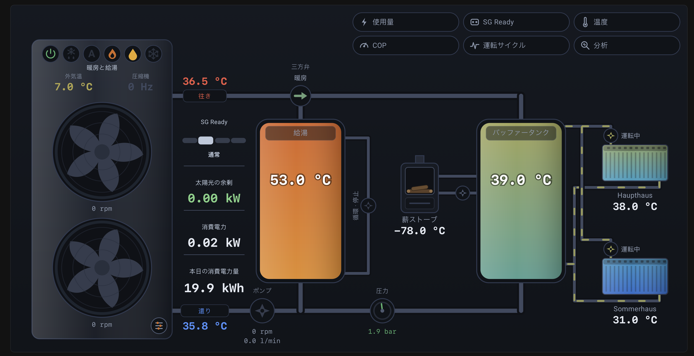

# Heatpump Flow Card by Lutarym

[English](README.md) · [Deutsch](README.de.md) · [Français](README.fr.md) · **日本語**



Panasonic Aquarea ヒートポンプを HeishaMon 経由で接続し、動くシステム図として表示する Home Assistant 用のアニメーション付き Lovelace カードです。

## 機能

- 室外機、暖房バッファー、1〜2 系統の暖房回路、給湯タンク、循環を含むシステム図
- 三方弁、ポンプ、圧縮機、バッファーの実際の配管動作に従う流れのアニメーション
- タンク、放熱器、配管の温度による色分け
- 回路1と回路2の暖房曲線を専用ウィンドウに表示。目盛り、運転点、調整可能な基準点つき
- ヒートポンプの扉：右下のボタンで前面が扉のように左へ開き、その奥に詳細設定（休暇、週間スケジュール、スマート給湯、暖房の外気温限界、温度差、レジオネラ対策、ポンプ、静音モード、暖房と給湯の今日の COP（0時からの熱量÷電力量）、暖房・給湯・合計の 1 月 1 日からの年間性能係数（JAZ、熱量と電力 kWh 付き、HeishaMon の値から算出）、運転時間と起動回数）があります。「適用」で変更を送信し、扉が閉じます
- ヘルプ画面（右下の「?」）：HeishaMon が読み書きできるすべての値と命令を分かりやすく説明。検索とグループ付き。各 TOP 値に対応するエンティティ ID 全体を表示し、クリックでコピー可能
- 24 メーカー・35 統合のデバイスプロファイル（Viessmann、NIBE、Daikin、Luxtronik、Stiebel Eltron、Vaillant など）をフォルダー `dist/Profile` のファイルとして同梱。メーカーごとに 1 ファイルで、統合ごとにバリエーションがあります。カードが合うバリエーションを自動で検出し、複数見つかった場合はエディターがどれを使うか尋ね、合うものがない場合は特定のプロファイルを読み込むか尋ねます。HeishaMon by Lutarym と HeishaMon (MQTT) 以外は未検証です。プロファイルの書き出し・調整・読み込みと GitHub での検索が可能です。[デバイスプロファイルの説明](docs/GERAETEPROFIL.ja.md) と [名前リスト](docs/NAMENSLISTE.ja.md) を参照
- 言語パック：言語をファイルに書き出し、自分で翻訳・調整して再び読み込めます。[言語パックの説明](docs/SPRACHPAKET.ja.md) を参照
- 過去24時間の使用量グラフ。暖房、給湯、待機で色分けし、その下に SG Ready の履歴
- 暖房バッファーのないシステムに対応。TOP99 で自動検出、または手動設定
- 最適化ごとのタブ付き分析（暖房カーブ、発停、ポンプ、給湯、ヒーター、霜取り、効率、電力と PV、設備）。目安と出典付きでやさしく説明。HeishaMon by Lutarym 1.7.0 以降の集計と HeishaMon 4.3.0・4.4.x の値（TOP144〜TOP198）を使用
- 横長と縦長のレイアウト
- 統合を自動検出するビジュアルエディター、設定の書き出しと読み込み
- 4 言語：英語、ドイツ語、フランス語、日本語

## 必要なもの

- Home Assistant 2024.1.0 以降
- HeishaMon。統合 HeishaMon by Lutarym または MQTT で接続
- MQTT 経由で暖房曲線を書き込む場合：Home Assistant の MQTT 統合

## インストール

### HACS

1. HACS を開き、三点メニューからカスタムリポジトリを選択
2. リポジトリ：`https://github.com/Lutarym/Heatpump-Flow-Card-by-Lutarym`、カテゴリ：**Dashboard**
3. カードを検索してダウンロード
4. HACS がリソースを自動登録します。ダッシュボードが YAML モードの場合は下記のとおり手動で追加してください
5. ブラウザーをキャッシュなしで再読み込み

### 手動

1. 最新リリースの `dist` フォルダから `heatpump-flow-card-by-lutarym.js`、`heatpump-flow-card-by-lutarym-hilfe.js` とフォルダー `Profile` をダウンロード
2. すべてを `<config>/www/community/heatpump-flow-card-by-lutarym/` にコピーし、フォルダー `Profile` はサブフォルダーにします。2 つ目のファイルはヘルプを含み、必要なときだけ読み込まれます。フォルダー `Profile` にはデバイスプロファイルが入っています。リソースとして登録するのは 1 つ目のファイルだけです。
3. 設定、ダッシュボード、三点メニュー、リソース、リソースを追加
4. URL `/local/community/heatpump-flow-card-by-lutarym/heatpump-flow-card-by-lutarym.js`、種類 **JavaScript モジュール**

## 設定

ビジュアルエディターを使うのが最も簡単です。カードを追加し、**統合から取り込む** を押してください。カードはデバイスプロファイルを使ってエンティティを自動で検出します（例：HeishaMon by Lutarym）。合うプロファイルがない場合、エディターが特定のプロファイルを読み込むか尋ねます。見つからないエンティティは手動で割り当てられます。

### YAML の例

```yaml
type: custom:heatpump-flow-card-by-lutarym
layout: quer
hk_count: 2
language: auto
entities:
  TOP14: sensor.heishamon_top14
  TOP6: sensor.heishamon_top6
  TOP5: sensor.heishamon_top5
  TOP8: sensor.heishamon_top8
  TOP20: sensor.heishamon_top20
  TOP46: sensor.heishamon_top46
  TOP10: sensor.heishamon_top10
  TOP36: sensor.heishamon_top36
  TOP42: sensor.heishamon_top42
```

エンティティ ID はカードの標準名です。実際の名前は異なる場合がありますが、エディターが自動で割り当てます。

6.0.0 以降、キーは [名前リスト](docs/NAMENSLISTE.ja.md) の名前です。`outside_temp` のような以前の項目名も引き続き使え、カードが自動で変換します。

### オプション

| オプション | 既定値 | 内容 |
|---|---|---|
| `layout` | `quer` | `quer` 横長、`hoch` 縦長、`klassisch` バージョン 4.9 までの横長（最大 2 回路、追加熱源なし） |
| `hk_count` | `2` | 暖房回路の数、1 から 4。回路 3 と 4 は独自エンティティが必要（Aquarea が制御するのは 2 ゾーンのみ） |
| `fan_count` | `2` | ファンの数、1 または 2 |
| `language` | `auto` | `auto`、`de`、`en`、`fr`、`ja` |
| `profil` | `auto` | `auto` は合うバリエーションを自動検出します。`keins` はプロファイルなし（記入したエンティティのみ）。または `heishamon_lutarym`、`heishamon`（MQTT 経由の HeishaMon）、`vicare`、`luxtronik2` などのバリエーション ID。一覧は[説明](docs/GERAETEPROFIL.ja.md)を参照 |
| `buffer_present` | `auto` | 暖房バッファー：`auto` は TOP99 に従う、`true` または `false` |
| `cop_reference` | 空 | COP 比較用データシート：`panasonic_tcap_m_12`（Panasonic Aquarea T-CAP M 12 kW、WH-WXG12ME5/ME8）。指定したときだけ COP タブで運転ごとに色分けします：データシートの92 %以上は緑（許容差 −8 %、HP KEYMARK）、未満は黄、試験点の範囲外は推定のみ（推定と表示）で淡色表示。空：COP は評価なし |
| `dhw_usable_temp` | 空 | 給湯が使えなくなるとみなすタンク温度（°C）。「給湯を観察」ウィンドウ（ヒートポンプのウィンドウのボタン）の保持時間に使います。空：値なし |
| `heat_load_kw` | 空 | 住宅の設計暖房負荷（kW、EN 12831）。`design_outdoor_temp`、`hp_capacity_kw`、暖房限界温度 TOP77 とあわせて分析でバイバレントポイントを計算し、「この温度未満でヒーター作動」（TOP78）と補助ヒーターの運転時間を比較します |
| `design_outdoor_temp` | 空 | 設置場所の設計外気温度（°C）。例：BWP 気候マップ（ドイツ、郵便番号別） |
| `hp_capacity_kw` | 空 | データシートのヒートポンプ暖房能力（kW）。設計外気温度とお使いの送水温度での値、ない場合は −7 °C の値。一定とみなします |
| `hp_capacity_ref` | 空 | `hp_capacity_kw` の条件：空＝設計外気温度、`a7`＝−7 °C（メーカー値）。分析項目「暖房能力の設計」で BWP ガイドラインの能力比（暖房能力 ÷ 設計暖房負荷）を使います：50 % 未満（−7 °C の値では 70 % 未満）なら不足 kW 付きで「小さすぎ」、それ以上は注意なしで「良好」 |
| `heater_share_max` | 空 | 目標値：年間暖房熱量のうち補助ヒーターが供給する上限（%）。分析項目「暖房能力の設計」で不足 kW を示します。空欄：評価なしで割合のみ |
| `hk1_room_target` | 空 | 回路1の希望室温（°C）。分析（タブ「暖房カーブ」）で室内センサー `EXT201` と比較します：±0.5 K 以内は良好（独自の設定：入力の刻み幅）、それ以外は EnergieSchweiz の手順付きで軽いずれ |
| `hk2_room_target` | 空 | `hk1_room_target` と同様、回路2と `EXT203` 用 |
| `circulation_present` | `auto` | 循環：`auto` はエンティティ割り当て時に表示、`true` または `false` |
| `show_history` | `knopf` | グラフ：`knopf` 右上の6つのボタンで使用量・SG Ready・温度・COP・運転サイクル・分析をウィンドウ表示し、ウィンドウには霜取りタブもあります（期間は24時間から1年まで選択可）、`true` 使用量を常にカードに表示、`false` オフ |
| `show_target` | `true` | バッファーと給湯に「目標 …」の行を表示 |
| `show_reload` | `true` | バッファーと給湯に「再加熱 …」の行を表示 |
| `show_help` | `true` | カード右下にヘルプの「?」ボタンを表示。ヘルプは HeishaMon の説明のため、HeishaMon のプロファイルとデモモードでのみ表示 |
| `show_door` | `true` | ヒートポンプ右下に詳細設定のボタンを表示 |
| `theme` | `auto` | 配色：`auto`（Home Assistant のライト／ダークに従う）、`dunkel`（ダーク）、`hell`（ライト）、`kontrast`（ハイコントラスト）、`nacht`（夜間・減光）、`ha`（Home Assistant テーマの色） |
| `profile_custom` | `[]` | 読み込んだデバイスプロファイルと GitHub から読み込んだデバイスプロファイル（エディターが設定、[説明](docs/GERAETEPROFIL.ja.md) 参照） |
| `language_custom` | `[]` | 読み込んだ言語パック（エディターが設定、[説明](docs/SPRACHPAKET.ja.md) 参照） |
| `history_width` | `450` | 使用量グラフの幅、250〜700 |
| `history_style` | `takte` | 使用量グラフの表示：`takte`（リングとサイクル帯）、`balken`（1時間ごとの棒グラフ）、`leuchten`（光る線とサイクル表示）、`linie`（従来の線） |
| `sg_style` | `spuren` | SG Ready の表示：`spuren`（状態ごとの行）、`stufen`（階段状の線）、`uhr`（24時間時計）、`band`（幅広の帯と割合バー） |
| `power_style` | `verlauf` | 分析の「電力と PV」の表示：`verlauf`（太陽の推移）、`bogen`（今日の太陽の弧。期間が 2 日以上なら各日も表示）、`balken`（1 時間ごと、3 時間ごと、または 1 日ごとの棒グラフ。期間が 2 日以上なら日と時間のマス目も表示）。期間は暦日で数えます：24 時間は今日の午前 0 時からです |
| `card_width` | `0` | 幅（ピクセル）、0 で自動 |
| `card_height` | `0` | 高さ（ピクセル）、0 で自動 |
| `pipe_inner_mm` | `0` | 配管内径（mm）、流量を色分け、0 で無効 |
| `mqtt_prefix` | `panasonic_heat_pump` | HeishaMon の MQTT プレフィックス |
| `curve_x_min / curve_x_max` | `-20 / 20` | 暖房曲線の外気目盛り（°C） |
| `curve_y_min / curve_y_max` | `20 / 75` | 暖房曲線の往き目盛り（°C） |
| `scale_min / scale_max` | `20 / 60` | 暖房の色分け範囲（°C） |
| `outdoor_min / outdoor_max` | `-15 / 35` | 外気センサーの色分け範囲（°C） |
| `label_hk1` から `label_hk4`、`label_buffer, label_dhw, label_energy` | | 独自の名前。空欄ならカードの言語 |
| `energy_daily` | `true` | メーター値から当日の使用量を計算 |
| `animate` | `true` | アニメーション：`true` オン、`false` オフ、`auto` 端末の設定（視差効果を減らす）に従う |
| `debug` | `false` | 左上に小さな枠を表示し、アニメーションの状態（タイル、実行中のアニメーション、再構築、毎秒フレーム数）と、アニメーションを再開するボタンを示します。アニメーションの不具合の調査用 |
| `hk1_style` から `hk4_style` | `platte` | 暖房回路の図：`platte` パネルラジエーター、`glieder` セクショナルラジエーター、`fbh` 床暖房（床に蛇行配管のある部屋の隅） |
| `extra_heat` | `aus` | バッファーの追加熱源：`aus`（オフ）、`kamin`（薪ストーブ）、`solar`（太陽熱）、`beide`（両方）。バッファーがある場合のみ |
| `kamin_fire_temp` | `30` | 薪ストーブ温度（°C）がこの値以上になると炎を表示 |
| `solar_sun_temp` | `30` | 集熱器温度（°C）がこの値以上になると太陽を表示 |
| `solar_style` | `strahlen` | 太陽熱の表示：`strahlen`（光線とセルの波）、`funkeln`（加熱ときらめき）、`roehren`（真空管集熱器） |
| `demo` | `false` | 試用のための仮の値 |

### エンティティ

すべての項目は任意です。エンティティのない項目はカード上に表示されません。コマンド名がある項目は、HeishaMon 経由で値を書き込めます。

| キー | 内容 | 備考 |
|---|---|---|
| **外気センサー** | | |
| `TOP14` | 外気温 | |
| **室外機** | | |
| `SET1` | ヒートポンプ状態、緑LED | SetHeatpump または TOP0 |
| `TOP8` | 圧縮機周波数 | |
| `TOP62` | ファン1回転数 | |
| `TOP63` | ファン2回転数 | |
| `TOP26` | 除霜中 | |
| `TOP44` | エラーコード | |
| `TOP0` | 運転状態 | |
| `SET12` | 強制除霜 | SetForceDefrost, switch |
| `SET4` | パワフル運転 | SetPowerfulMode, select |
| `SET3` | 静音運転 | SetQuietMode, select |
| `EXT1` | 現在の消費電力 | Shelly PM, Watt |
| `EXT2` | 電力量計 | Shelly PM, kWh |
| **SG Ready** | | |
| `EXT3` | 現在の太陽光出力 | 独自エンティティ、ワット |
| `EXT4` | 系統受電 | 独自エンティティ、ワット、正 = 受電。HeishaMon by Lutarym（オプション「系統受電センサー」）が値を出さない場合、`EXT1` と合わせてカードが「今日の系統電力」を計算 |
| `EXT100` | 接点K1 停止 | Shelly、リレーまたは入力 |
| `EXT101` | 接点K2 起動 | Shelly、リレーまたは入力 |
| **一次回路** | | |
| `TOP6` | 往き温度 | |
| `TOP5` | 還り温度 | |
| `TOP65` | 一次ポンプ回転数 | |
| `TOP1` | 流量 | |
| `TOP20` | 三方弁 | |
| `TOP115` | 水圧 | |
| `TOP60` | 内部ヒーター運転中 | |
| `TOP61` | 外部ヒーター運転中 | |
| **暖房バッファー** | | |
| `TOP46` | バッファー温度 | |
| `TOP99` | バッファーあり | |
| `SET28` | バッファー運転の入切 | SetBuffer, switch |
| **暖房曲線** | | |
| `TOP29` | 回路1 暖房曲線 往き 高 | |
| `TOP30` | 回路1 暖房曲線 往き 低 | |
| `TOP31` | 回路1 暖房曲線 外気 高 | |
| `TOP32` | 回路1 暖房曲線 外気 低 | |
| `TOP82` | 回路2 暖房曲線 往き 高 | |
| `TOP83` | 回路2 暖房曲線 往き 低 | |
| `TOP84` | 回路2 暖房曲線 外気 高 | |
| `TOP85` | 回路2 暖房曲線 外気 低 | |
| **暖房バッファー** | | |
| `TOP113` | バッファー上乗せ温度（ΔT） | TOP113、バッファー目標 = 回路目標 + ΔT |
| `TOP7` | ヒートポンプ往き目標温度 | |
| `EXT600` | COP 暖房 | HeishaMon by Lutarym、ヒートポンプの電力値がない場合のみ使用（ある場合は TOP15/TOP16 から熱量÷電力量）。ソースは統合の COP ソースで選択 |
| `TOP59` | 暖房ヒーター許可 | |
| `SET45` | 暖房ヒーター許可の切替 | SetRoomHeaterState, switch |
| **回路1** | | |
| `TOP94` | 有効なゾーン | 両方に適用 |
| `SET17` | ゾーン切替 | SetZones, 両方に適用 |
| `TOP36` | 回路1 水温 | |
| `TOP42` | 回路1 目標水温 | |
| `TOP124` | 回路1 ポンプ運転中 | |
| `TOP27` | 回路1 設定温度 | number |
| `EXT200` | 回路1 入切 | 独自スイッチ、任意 |
| `EXT201` | 回路1 室温 | 室内センサー、任意 |
| **回路2** | | |
| `TOP37` | 回路2 水温 | |
| `TOP43` | 回路2 目標水温 | |
| `TOP123` | 回路2 ポンプ運転中 | |
| `TOP34` | 回路2 設定温度 | number |
| `EXT202` | 回路2 入切 | 独自スイッチ、任意 |
| `EXT203` | 回路2 室温 | 室内センサー、任意 |
| `EXT204, EXT207` | 回路3、4 水温 | 独自エンティティ、°C |
| `EXT205, EXT208` | 回路3、4 ポンプ運転中 | 独自のスイッチまたはセンサー |
| `EXT206, EXT209` | 回路3、4 入切 | 独自スイッチ、任意 |
| `EXT300` | 薪ストーブ温度 | 独自エンティティ、°C。薪ストーブのみ：TOP47 |
| `EXT301` | 薪ストーブ ポンプ運転中 | 独自のスイッチまたはセンサー。薪ストーブのみ：OPT5 |
| `TOP47` | 太陽熱温度 | |
| `OPT5` | 太陽熱ポンプ運転中 | |
| **給湯** | | |
| `TOP100` | 給湯あり | |
| `TOP10` | 給湯温度 | |
| `TOP22` | 給湯のヒステリシス | |
| `TOP9` | 給湯設定温度 | number |
| `EXT601` | COP 給湯 | HeishaMon by Lutarym、ヒートポンプの電力値がない場合のみ使用（ある場合は TOP40/TOP41 から熱量÷電力量）。ソースは統合の COP ソースで選択 |
| `TOP58` | 給湯ヒーター許可 | |
| `SET10` | 一回だけ加熱 | SetForceDHW, switch |
| `TOP2` | 加熱中 | |
| `SET13` | レジオネラ運転を開始 | SetForceSterilization, switch |
| `TOP69` | レジオネラ運転中 | |
| `SET44` | 給湯ヒーター許可の切替 | SetDHWHeaterState, switch |
| `EXT400` | 循環ポンプ運転中 | Shellyまたは独自スイッチ |
| `EXT401` | 循環スイッチ（クリック可） | 循環の入切スイッチ |
| `EXT500` | 天気予報 | weather、1時間ごとの予報。空欄：HeishaMon by Lutarym と同じ、なければ自動。「給湯を観察」ウィンドウの最適な沸き上げ時刻に使用 |
| `EXT402` | 最も暖かい時間帯に給湯 | HeishaMon by Lutarym 1.4.0 以降、switch。ヒートポンプのウィンドウのボタン。「給湯を観察」ウィンドウの「最適化」タブで予定ありの日と予定なしの日を分けます |
| `EXT403` | 給湯の予定時刻 | HeishaMon by Lutarym 1.4.0 以降、sensor。ヒートポンプのウィンドウと、「昼か夜か」タブの「予定の給湯」に表示 |
| `EXT404` | 前回の給湯運転 | HeishaMon by Lutarym 1.4.0 以降、sensor。ヒートポンプのウィンドウに表示。統合が開始した沸き上げに印を付けます |
| **制御** | | |
| `SET9` | 運転モード切替 | SetOperationMode, select |
| **詳細設定** | | |
| `TOP77` | 暖房停止 外気温 | number |
| `TOP78` | ヒーター開始 外気温 | number |
| `TOP23` | 暖房温度差 (ΔT) | number |
| `SET39` | 暖房制御 | SetHeatingControl, select |
| `TOP70` | レジオネラ対策温度 | number |
| `TOP71` | レジオネラ対策保持時間 | number |
| `SET42` | ポンプ制御 | SetPumpFlowrateMode, select |
| `TOP95` | ポンプ最大出力 | number |
| `SET41` | 静音モード優先 | SetQuietModePriority, select |
| `SET2` | 休暇モード | SetHolidayMode, switch |
| `SET24` | 週間スケジュール | SetMainSchedule, switch |
| `SET40` | スマート給湯 | SetSmartDHW, select |
| `TOP11` | 運転時間 | |
| `TOP12` | 圧縮機起動回数 | |
| `TOP90` | 暖房ヒーター運転時間 | |
| `TOP91` | 給湯ヒーター運転時間 | |

## 言語

カードは Home Assistant の言語に従います。対応していない場合は英語で表示されます。`language` で言語を固定できます。

## 変更履歴

[CHANGELOG.md](CHANGELOG.md) を参照してください。

## ライセンス

GNU General Public License v3.0。[LICENSE](LICENSE) を参照してください。
