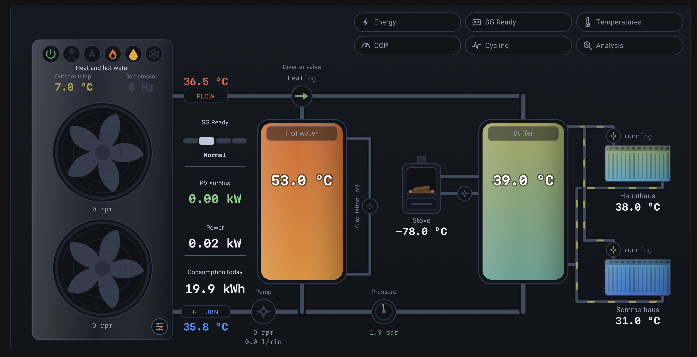

# Heatpump Flow Card by Lutarym

**English** · [Deutsch](README.de.md) · [Français](README.fr.md) · [日本語](README.ja.md)



Animated Lovelace card for Home Assistant that shows a Panasonic Aquarea heat pump system as a live plant diagram, connected through HeishaMon.

## Features

- Plant diagram with outdoor unit, heating buffer, one or two heating circuits, hot water tank and circulation
- Flow animation that follows the real hydraulics: diverter valve, pumps, compressor and buffer
- Temperature colouring of tanks, radiators and pipes
- Heat curve for circuit 1 and 2 in its own window, with scale, operating point and adjustable corner points
- Door in the heat pump: the button at the bottom right opens the front like a door to the left, behind it are advanced settings (holiday mode, weekly schedule, Smart DHW, heating limits, spread, legionella protection, pump, quiet mode, today's COP for heating and hot water (heat divided by electricity since midnight), seasonal performance factor (JAZ) for heating, hot water and total since 1 January with heat and electricity in kWh, from HeishaMon values, operating hours and starts); changes are sent with “Apply” and the door closes
- Help window (“?” at the bottom right): plain-language explanation of every value and command HeishaMon can read and write, with search and groups; for every TOP value the full entity ID, copyable with one click
- Device profiles for 35 integrations of 24 manufacturers (Viessmann, NIBE, Daikin, Luxtronik, Stiebel Eltron, Vaillant and more) as files in the folder `dist/Profile`, one file per manufacturer with one variant per integration. The card detects the matching variant itself; if several are found, the editor asks which one to use, if none fits, it asks for a specific profile. Apart from HeishaMon by Lutarym and HeishaMon (MQTT) they are untested. Profiles can be exported, adapted, imported and searched on GitHub; see the [device profile guide](docs/GERAETEPROFIL.md) and the [name list](docs/NAMENSLISTE.md)
- Language packs: export a language as a file, translate it yourself or adjust it and import it again; see the [language pack guide](docs/SPRACHPAKET.md)
- Energy chart for the past 24 hours, coloured by heating, hot water and standby, with the SG Ready history below
- Systems without a heating buffer, detected automatically from TOP99 or set manually
- Analysis with one tab per optimisation (heating curve, cycling, pump, hot water, backup heater, defrost, efficiency, power & PV, system), explained in plain words with guide values and sources; uses the evaluations of HeishaMon by Lutarym from 1.7.0 and the values of HeishaMon 4.3.0 and 4.4.x (TOP144 to TOP198)
- Landscape and portrait layout
- Visual editor with automatic detection of the integration, import and export of the configuration
- Four languages: English, German, French and Japanese

## Requirements

- Home Assistant 2024.1.0 or later
- HeishaMon, connected either through the integration HeishaMon by Lutarym or through MQTT
- For writing the heat curve through MQTT: the MQTT integration in Home Assistant

## Installation

### HACS

1. Open HACS, menu with the three dots, Custom repositories
2. Repository: `https://github.com/Lutarym/Heatpump-Flow-Card-by-Lutarym`, category: **Dashboard**
3. Search for the card and download it
4. HACS registers the resource automatically. If your dashboards run in YAML mode, add it yourself, see below
5. Reload the browser without cache

### Manual

1. Download `heatpump-flow-card-by-lutarym.js`, `heatpump-flow-card-by-lutarym-hilfe.js` and the folder `Profile` from the `dist` folder of the latest release
2. Copy everything to `<config>/www/community/heatpump-flow-card-by-lutarym/`, the folder `Profile` as a subfolder. The second file contains the help and is only loaded when needed, the folder `Profile` contains the device profiles; only the first file is added as a resource.
3. Settings, Dashboards, menu with the three dots, Resources, add resource
4. URL `/local/community/heatpump-flow-card-by-lutarym/heatpump-flow-card-by-lutarym.js`, type **JavaScript module**

## Configuration

The easiest way is the visual editor: add the card, then press **Take over from integration**. The card detects the entities on its own through the device profiles, for example with HeishaMon by Lutarym. If no profile fits, the editor asks for a specific profile. Entities that are not found can be assigned by hand.

### Example in YAML

```yaml
type: custom:heatpump-flow-card-by-lutarym
layout: quer
hk_count: 2
language: auto
entities:
  TOP14: sensor.heishamon_top14
  TOP6: sensor.heishamon_top6
  TOP5: sensor.heishamon_top5
  TOP8: sensor.heishamon_top8
  TOP20: sensor.heishamon_top20
  TOP46: sensor.heishamon_top46
  TOP10: sensor.heishamon_top10
  TOP36: sensor.heishamon_top36
  TOP42: sensor.heishamon_top42
```

The entity IDs are the default names of the card. Your entities may be named differently, the editor assigns them automatically.

From 6.0.0 the keys are the names of the [name list](docs/NAMENSLISTE.md). Former field names such as `outside_temp` keep working, the card converts them itself.

### Options

| Option | Default | Meaning |
|---|---|---|
| `layout` | `quer` | `quer` landscape, `hoch` portrait, `klassisch` landscape as up to version 4.9 (at most 2 circuits, no additional heat) |
| `hk_count` | `2` | Number of heating circuits, 1 to 4. Circuits 3 and 4 need own entities, the Aquarea controls only two zones |
| `fan_count` | `2` | Number of fans, 1 or 2 |
| `language` | `auto` | `auto`, `de`, `en`, `fr` or `ja` |
| `profil` | `auto` | `auto` detects the matching variant automatically, `keins` no profile (only entered entities), or the ID of a variant such as `heishamon_lutarym`, `heishamon` (HeishaMon via MQTT), `vicare`, `luxtronik2`; list in the [guide](docs/GERAETEPROFIL.md) |
| `buffer_present` | `auto` | Heating buffer: `auto` from TOP99, `true` or `false` |
| `cop_reference` | empty | Datasheet for the COP comparison: `panasonic_tcap_m_12` (Panasonic Aquarea T-CAP M 12 kW, WH-WXG12ME5/ME8). Only then does the COP tab colour each run: green from 92 % of the datasheet (tolerance −8 %, HP KEYMARK), yellow below, outside the rating points only estimated, marked as an estimate and drawn pale. Empty: COP not rated |
| `dhw_usable_temp` | empty | Tank temperature in °C below which hot water counts as no longer usable. Used for the holding time in the window "Monitor hot water" (button in the heat pump window). Empty: column without a value |
| `heat_load_kw` | empty | Design heating load of the house in kW (EN 12831). With `design_outdoor_temp`, `hp_capacity_kw` and the heating limit TOP77, the analysis calculates the bivalence point and compares "heater on below" (TOP78) and the heater run time with it |
| `design_outdoor_temp` | empty | Design outdoor temperature of the location in °C, e.g. from the BWP climate map (Germany, by postcode) |
| `hp_capacity_kw` | empty | Heating capacity of the heat pump in kW from the datasheet, at the design outdoor temperature and your flow temperature; if missing, the value at −7 °C. Counts as constant |
| `hp_capacity_ref` | empty | Where `hp_capacity_kw` applies: empty = design outdoor temperature, `a7` = −7 °C (manufacturer value). The analysis point "Heating capacity, sizing" uses the capacity share (capacity / design heating load) of the BWP guideline: below 50 % (with the −7 °C value: below 70 %) a hint "too small" with the missing kW; above that "fine" without a hint |
| `heater_share_max` | empty | Your target: at most this share of the annual space heat in % from the backup heater. The analysis point "Heating capacity, sizing" then shows a hint with the missing kW. Empty: share without rating |
| `hk1_room_target` | empty | Desired room temperature of circuit 1 in °C. The analysis (tab Heating curve) compares it with the room sensor `EXT201`: within ±0.5 K fine (own decision: step size of the input), otherwise a slight deviation with the procedure of EnergieSchweiz |
| `hk2_room_target` | empty | Like `hk1_room_target`, for circuit 2 and `EXT203` |
| `circulation_present` | `auto` | Circulation: `auto` once an entity is assigned, `true` or `false` |
| `show_history` | `knopf` | Charts: `knopf` six buttons at the top right open energy, SG Ready, temperatures, COP, cycling and analysis in a window (with an extra tab for defrosts), period selectable from 24 hours to 1 year, `true` energy always in the card, `false` off |
| `show_target` | `true` | Show the “Target …” line in buffer and hot water |
| `show_reload` | `true` | Show the “Reloads at …” line in buffer and hot water |
| `show_help` | `true` | Show the “?” help button at the bottom right of the card; the help describes HeishaMon and only appears with HeishaMon profiles and in demo mode |
| `show_door` | `true` | Show the advanced settings button at the bottom right of the heat pump |
| `theme` | `auto` | Colour scheme: `auto` (follows light/dark mode of Home Assistant), `dunkel` (dark), `hell` (light), `kontrast` (high contrast), `nacht` (night, dimmed), `ha` (colours of the Home Assistant theme) |
| `profile_custom` | `[]` | Imported and GitHub-loaded device profiles (set by the editor, see [guide](docs/GERAETEPROFIL.md)) |
| `language_custom` | `[]` | Imported language packs (set by the editor, see [guide](docs/SPRACHPAKET.md)) |
| `history_width` | `450` | Width of the energy chart, 250 to 700 |
| `history_style` | `takte` | Energy chart style: `takte` (ring and cycle band), `balken` (bars per hour), `leuchten` (glowing line with cycle marks), `linie` (previous line) |
| `sg_style` | `spuren` | SG Ready chart style: `spuren` (lane per state), `stufen` (step line), `uhr` (24-hour clock), `band` (wide band with share bar) |
| `power_style` | `verlauf` | Power & PV chart style in the analysis: `verlauf` (sun curve), `bogen` (today's sun arc, from two days in the period also the individual days), `balken` (bars per hour, per 3 hours or per day, from two days also a grid per day and hour). The period counts in calendar days: 24 hours means today from midnight |
| `card_width` | `0` | Width in pixels, 0 is automatic |
| `card_height` | `0` | Height in pixels, 0 is automatic |
| `pipe_inner_mm` | `0` | Inner pipe diameter in mm, colours the flow rate, 0 is off |
| `mqtt_prefix` | `panasonic_heat_pump` | MQTT topic prefix of HeishaMon |
| `curve_x_min / curve_x_max` | `-20 / 20` | Outdoor scale of the heat curve in °C |
| `curve_y_min / curve_y_max` | `20 / 75` | Flow scale of the heat curve in °C |
| `scale_min / scale_max` | `20 / 60` | Colour scale for heating in °C |
| `outdoor_min / outdoor_max` | `-15 / 35` | Colour scale for the outdoor sensor in °C |
| `label_hk1` to `label_hk4`, `label_buffer, label_dhw, label_energy` | | Own names, empty uses the card language |
| `energy_daily` | `true` | Calculate daily energy from the meter reading |
| `animate` | `true` | Animation: `true` on, `false` off, `auto` the device decides (setting "reduce motion") |
| `debug` | `false` | Shows a small box in the top left with what the animation is doing (tiles, running animations, rebuilds, frames per second) and a button that restarts the animations. For analysing animation problems |
| `hk1_style` to `hk4_style` | `platte` | Picture of the heating circuit: `platte` panel radiator, `glieder` column radiator, `fbh` underfloor heating (room corner with pipe coil in the floor) |
| `extra_heat` | `aus` | Additional heat at the buffer: `aus` (off), `kamin` (stove), `solar`, `beide` (both). Only with a heating buffer |
| `kamin_fire_temp` | `30` | From this stove temperature in °C the fire burns in the stove |
| `solar_sun_temp` | `30` | From this collector temperature in °C the sun shines above the solar thermal collector |
| `solar_style` | `strahlen` | Solar thermal style: `strahlen` (light rays and cell wave), `funkeln` (warming and sparkle), `roehren` (tube collector) |
| `demo` | `false` | Sample values for trying out |

### Entities

All fields are optional. A field without an entity is hidden on the card. Where a command name is given, the card can write the value through HeishaMon.

| Key | Meaning | Note |
|---|---|---|
| **Outdoor sensor** | | |
| `TOP14` | Outdoor temperature | |
| **Outdoor unit** | | |
| `SET1` | Heat pump status, green LED | SetHeatpump or TOP0 |
| `TOP8` | Compressor frequency | |
| `TOP62` | Fan 1 speed | |
| `TOP63` | Fan 2 speed | |
| `TOP26` | Defrost running | |
| `TOP44` | Error code | |
| `TOP0` | Operating state | |
| `SET12` | Force defrost | SetForceDefrost, switch |
| `SET4` | Powerful mode | SetPowerfulMode, select |
| `SET3` | Quiet mode | SetQuietMode, select |
| `EXT1` | Current power draw | Shelly PM, Watt |
| `EXT2` | Energy meter | Shelly PM, kWh |
| **SG Ready** | | |
| `EXT3` | Current PV power | own entity, watts |
| `EXT4` | Grid import | own entity, watts, positive = import. Together with `EXT1` the card calculates "From grid today" if HeishaMon by Lutarym (option "Grid import sensor") does not provide it |
| `EXT100` | Contact K1, block | Shelly, relay or input |
| `EXT101` | Contact K2, start | Shelly, relay or input |
| **Primary circuit** | | |
| `TOP6` | Flow temperature | |
| `TOP5` | Return temperature | |
| `TOP65` | Primary pump speed | |
| `TOP1` | Flow rate | |
| `TOP20` | Three-way diverter valve | |
| `TOP115` | Water pressure | |
| `TOP60` | Internal heater running | |
| `TOP61` | External heater running | |
| **Heating buffer** | | |
| `TOP46` | Buffer temperature | |
| `TOP99` | Buffer installed | |
| `SET28` | Buffer mode on and off | SetBuffer, switch |
| **Heat curve** | | |
| `TOP29` | Circuit 1 heat curve, flow high | |
| `TOP30` | Circuit 1 heat curve, flow low | |
| `TOP31` | Circuit 1 heat curve, outdoor high | |
| `TOP32` | Circuit 1 heat curve, outdoor low | |
| `TOP82` | Circuit 2 heat curve, flow high | |
| `TOP83` | Circuit 2 heat curve, flow low | |
| `TOP84` | Circuit 2 heat curve, outdoor high | |
| `TOP85` | Circuit 2 heat curve, outdoor low | |
| **Heating buffer** | | |
| `TOP113` | Buffer offset (ΔT) | buffer target = circuit target + ΔT |
| `TOP7` | Heat pump flow target | |
| `EXT600` | COP heating | HeishaMon by Lutarym, only used without the heat pump's power values (otherwise heat divided by electricity from TOP15/TOP16); source selectable in the integration under COP source |
| `TOP59` | Heating element, heating: allowed | |
| `SET45` | Allow heating element, heating | SetRoomHeaterState, switch |
| **Circuit 1** | | |
| `TOP94` | Active zones | applies to both |
| `SET17` | Switch zones | SetZones, applies to both |
| `TOP36` | Circuit 1 water temperature | |
| `TOP42` | Circuit 1 water target | |
| `TOP124` | Circuit 1 pump running | |
| `TOP27` | Circuit 1 adjustable target | number |
| `EXT200` | Circuit 1 on and off | own switch, optional |
| `EXT201` | Circuit 1 room temperature | room sensor, optional |
| **Circuit 2** | | |
| `TOP37` | Circuit 2 water temperature | |
| `TOP43` | Circuit 2 water target | |
| `TOP123` | Circuit 2 pump running | |
| `TOP34` | Circuit 2 adjustable target | number |
| `EXT202` | Circuit 2 on and off | own switch, optional |
| `EXT203` | Circuit 2 room temperature | room sensor, optional |
| `EXT204, EXT207` | Water temperature circuit 3, 4 | own entity, °C |
| `EXT205, EXT208` | Pump circuit 3, 4 running | own switch or sensor |
| `EXT206, EXT209` | Circuit 3, 4 on and off | own switch, optional |
| `EXT300` | Stove temperature | own entity, °C; stove only: TOP47 |
| `EXT301` | Stove pump running | own switch or sensor; stove only: OPT5 |
| `TOP47` | Solar thermal temperature | |
| `OPT5` | Solar thermal pump running | |
| **Hot water** | | |
| `TOP100` | Hot water installed | |
| `TOP10` | Hot water temperature | |
| `TOP22` | Hot water hysteresis | |
| `TOP9` | Hot water target | number |
| `EXT601` | COP hot water | HeishaMon by Lutarym, only used without the heat pump's power values (otherwise heat divided by electricity from TOP40/TOP41); source selectable in the integration under COP source |
| `TOP58` | Heating element, hot water: allowed | |
| `SET10` | Boost once | SetForceDHW, switch |
| `TOP2` | Boost running | |
| `SET13` | Start legionella cycle | SetForceSterilization, switch |
| `TOP69` | Legionella cycle running | |
| `SET44` | Allow heating element, hot water | SetDHWHeaterState, switch |
| `EXT400` | Circulation pump running | Shelly or own switch |
| `EXT401` | Circulation switch (clickable) | switch to turn circulation on and off |
| `EXT500` | Weather forecast | weather, hourly forecast; empty: as in HeishaMon by Lutarym, otherwise automatic. For the best charging time in the window "Monitor hot water" |
| `EXT402` | Hot water at the warmest time of day | HeishaMon by Lutarym 1.4.0 or newer, switch. Button in the heat pump window; separates days with and without the plan for the tab "Optimisation" in the window "Monitor hot water" |
| `EXT403` | Planned hot water charge | HeishaMon by Lutarym 1.4.0 or newer, sensor. In the heat pump window and as "Planned charge" in the tab "Day or night" |
| `EXT404` | Last hot water charge | HeishaMon by Lutarym 1.4.0 or newer, sensor. In the heat pump window; marks the charges started by the integration |
| **Control** | | |
| `SET9` | Switch operating mode | SetOperationMode, select |
| **Advanced settings** | | |
| `TOP77` | Heating off above outdoor temp. | number |
| `TOP78` | Heater on below outdoor temp. | number |
| `TOP23` | Heating spread (ΔT) | number |
| `SET39` | Heating control | SetHeatingControl, select |
| `TOP70` | Legionella temperature | number |
| `TOP71` | Legionella hold time | number |
| `SET42` | Pump control | SetPumpFlowrateMode, select |
| `TOP95` | Max. pump duty | number |
| `SET41` | Quiet mode priority | SetQuietModePriority, select |
| `SET2` | Holiday mode | SetHolidayMode, switch |
| `SET24` | Weekly schedule | SetMainSchedule, switch |
| `SET40` | Smart DHW | SetSmartDHW, select |
| `TOP11` | Operating hours | |
| `TOP12` | Compressor starts | |
| `TOP90` | Heater hours, heating | |
| `TOP91` | Heater hours, hot water | |

## Languages

The card follows the language of Home Assistant. If it is not supported, English is used. A fixed language can be set with `language`.

## Changes

See [CHANGELOG.md](CHANGELOG.md).

## License

GNU General Public License v3.0, see [LICENSE](LICENSE).
